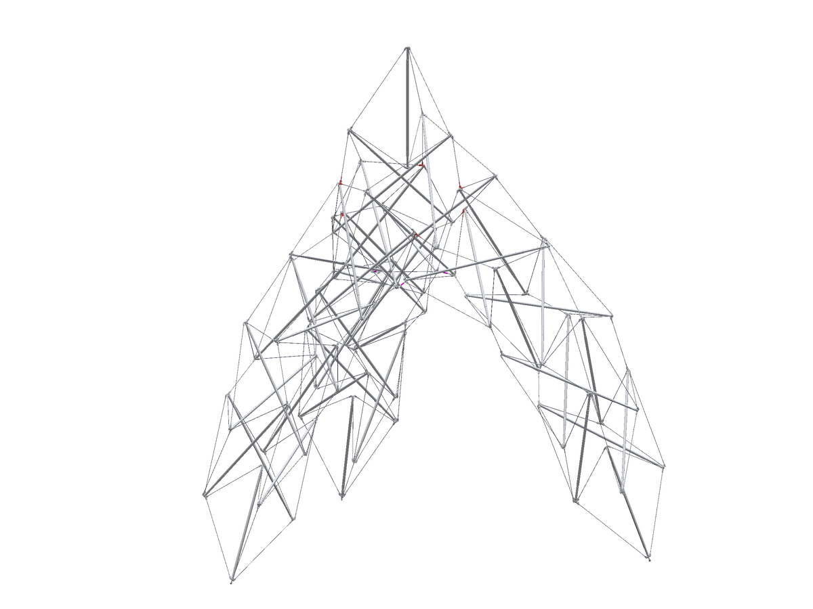
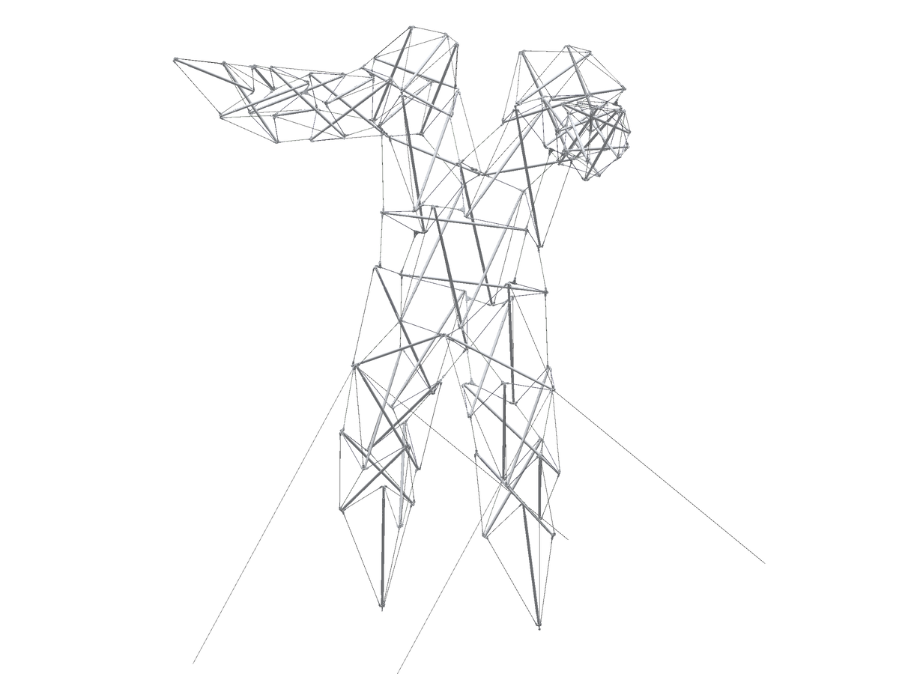

# Tensegrity Lab

Tensegrity Lab is for efficiently exploring spatial structures based on
pure pairwise push and pull forces using the [Rust](https://www.rust-lang.org/) stack,
and for building them for real.

*Open Claw, built in 2026: 46 struts in threefold symmetry, standing on three truss columns. Red marks
cable ends whose hardware collides, magenta cables too short to make.*

*Headless Hug, next, to be built in 2027: standing on its two feet and held by four guy lines, 64 aluminium
struts and 240 steel cables, about 8 m tall.*

*Both are drawn by the app's own renderer: `cargo test --release --lib export_readme_images -- --ignored`.*

The goals of this project are:

* have a fast implementation of [Elastic Interval Geometry](docs/EIG.md), both native and web
* design tensegrity by melting tensegrity modules or "bricks" together, using a [Rust-embedded DSL](docs/DSL.md)
* facilitate the building of designed structures with real materials: the connectors, the parts list, laser-cutting drawings and the structural engineer's model all come from the simulation
* construct a Darwinian evolution of competing tensegrities with arbitrary fitness function

### Two Versions

There are two different versions which are maintained in parallel, the web version and the native version.

1. The native version is for designing tensegrities using the [Rust DSL](docs/DSL.md), and for preparing them to be built. Structures are defined programmatically in Rust and compiled directly into the binary. This provides type safety and better tooling than the older script-based approach.
2. The web version allows for selecting from the existing designs and is intended to facilitate building the physical tensegrity structures. When you click on the structure, you select a joint, and then you can select one of its adjacent intervals. The details about the interval appear above so you can construct a real world tensegrity. Scale can be calibrated easily.

None of this is really documented well enough yet that it is easy for beginners. You kind of have to want to dig in.

If you want to know more, please contact **pretenst@gmail.com**.

### Documentation

* [DSL](docs/DSL.md) — defining fabrics and their build plans
* [Elastic Interval Geometry](docs/EIG.md) — the physics
* [Joint naming](docs/joint-naming.md) — how joints and everything attached to them are named
* [Connectors](docs/connectors.md) — the hardware joining cables to struts, bridles and the parts list
* [Parts](docs/parts.md) — Headless Hug's bill of materials, part designs, sourcing and ordering
* [Fabric JSON](docs/fabric-json.md) — Headless Hug as built, for the structural engineer, and the handoff package
* [Bouwboek](docs/bouwboek/headless-hug.md) — the template for the engineer's report (in Dutch)
* [Open Claw summary](docs/openclaw-software-summary.md), [labeling symmetries](docs/labeling-symmetries.md)
* [GPU compute backend](docs/gpu-compute-backend.md), [evolution](docs/evolution.md), [articulation evolution](docs/articulation-evolution.md), [robot notes](docs/robot.md)

### Running Tensegrity Lab

First you will need Rust installed, and your copy of the source code.

1. [install rust](https://www.rust-lang.org/tools/install)
2. clone the [repository](https://github.com/elastic-interval/tensegrity-lab.git)
3. move into the **tensegrity-lab** directory

To run the native version:

    cargo run --release -- --fabric "Headless Hug"

The fabrics are `Headless Hug`, `Open Claw`, `Halo by Crane`, `Twisted Infinity`, `Propeller` and `Diamond`;
`--cycle` walks through them all. The window lists the keys that work at each moment.

To run the web version, [install trunk](https://trunkrs.dev/guide/getting-started/installation.html), then:

    trunk serve

To prepare a distribution for in a subdirectory /lab/:

    trunk build --release --public-url /lab

### Building Headless Hug

The handoff package — the figure as built in JSON, the engineer's RFEM script, laser-cutting drawings,
the welding document, figures and the draft Bouwboek — comes from one build:

    cargo test --release --lib export_headless_hug_package -- --ignored

and the Bouwboek as a PDF from that ([WeasyPrint](https://weasyprint.org/) needed):

    python3 scripts/bouwboek/pdf.py HeadlessHug-<date>/HeadlessHug-bouwboek-<date>.md
